# 经营证据链 · Evidence Chain

> 工商银行企业命题二：AI 驱动的行业研究与企业经营分析助手
> 单人开发原型 · Python 3.13 / FastAPI / SQLite + React / TypeScript / ECharts

**一句话**：不是自动写研报的聊天框，而是一张**可复核、可更新**的企业研究底稿——
每个数字能点回原表的某一格，每条结论有引用与反证，每次新增一期年报只改受影响的部分。

### 30 秒版

- **解决什么问题**：研究员要在年报、政策、行业资料与市场数据之间找关联，还要判断异常数据背后的经营风险；难点不是写结论，而是证明结论来自哪里、错了能否定位。
- **已经实现**：六个 AI 角色分工协作；54 份真实年报、1,015 条原件事实、4,564 条第三方数据；四层证据链、证据地图、同业对比、29 节点 / 84 关系的啤酒产业链图谱、版本补证、追问与公开评测。
- **如何运行**：`.\start.ps1`（Windows）或 `./start.sh`，然后打开 <http://127.0.0.1:8000/>；首次拉取真实年报见[快速开始](#六快速开始)。

### 六个agent角色说明

| 角色 | 实际职责 | mock 模式 | live 模式 |
|---|---|---|---|
| 计划 PLAN | 生成覆盖矩阵，标出缺哪年哪字段 | 按字段字典扫描 | 同样走确定性扫描（不消耗模型调用） |
| 资料 COLLECT | 提出查询提案与预期发布方 | 按缺口模板生成 | 模型生成检索提案 |
| 财务 FINANCE | 指认单元格，不返回数字 | 主表行名匹配 | 模型选择候选单元格 |
| 行业 INDUSTRY | 行业事实、政策链接、关系候选 | 规则与图谱 | 模型给出事实与候选，关系边以结构化图谱为准并逐条校验 |
| 风险 RISK | 只解释已触发的规则 | 规则文案 | 模型写反证与下一份材料 |
| 审核 AUDIT | 引用可达、口径、数字绑定 | 程序校验 | 模型做语义复检 |

无论哪种模式，输出都要通过固定字段校验；live 失败会自动回落确定性模板，并在研究台的「Agent 协作记录」里标明 `大模型 / 确定性策略`、调用次数与是否回落。数字、结论与发布判定始终由确定性链路给出。


## 一、它解决什么问题

研究员不缺结论，缺的是「这条结论凭什么」。真实的行业研究要做四件事：
读两百页年报、把企业放进行业里比、算清指标、判断异常背后的经营风险。
四件事都会出错，而且错了不容易发现：

| 断点 | 具体表现 | 本项目的处理 |
|---|---|---|
| 材料分散 | 同一指标散落在管理层讨论、三张主表、十几条附注与更正公告里 | 只认主表：按「年份 + 合并/母公司」表头定位，附注页整段排除并留痕 |
| 口径易错 | 合并/母公司并列、万元/元混排、期末/期初同表 | 口径进 `FactKey`；单位换算单独记录；错位时给出 `SCOPE_MISMATCH` 说明 |
| 结论不可复核 | 报告给不出页码，错了也定位不到 | 四层证据链：指标 → 算式 → 单元格 → 原件（含 SHA-256 与披露日） |

---

## 二、真实数据，不是合成样本

| 维度 | 规模 | 来源 |
|---|---|---|
| 行业 | 6 个（啤酒 / 白酒 / 乳制品 / 家用电器 / 汽车整车 / 光伏设备） | — |
| 公司 | 18 家 A 股（每行业 3 家：龙头 / 次龙头 / 差异化） | 交易所简称 |
| 年报原件 | **54 份**（2023–2025 三期，全部为法定披露 PDF） | 巨潮资讯 |
| 原件抽取事实 | **1,015 条**（带页码、单元格、高亮框） | 自研行锚定抽取器 |
| 第三方结构化事实 | **4,564 条**（30 年 × 10 字段 × 18 家） | 东方财富公开接口 |
| 产业链知识 | **126 个节点 / 324 条关系**（啤酒行业 29 / 84） | `config/chains/*.yaml`，按五层组织、逐条标依据 |

**为什么要有两个来源**：一份用来做证据（PDF 可点回原页），一份用来做参照（结构化、覆盖全）。
两者独立录入，才能互相校验——这也是评测不「自己出题自己答」的前提。

---

## 三、评测：84.1% 的跨源一致率，失败样本全部公开

评测不设自建金标。规则写死在 `app/eval/crosscheck.py`：

- 输入：巨潮年报 PDF 的抽取结果；
- 参照：东方财富按自己口径录入的结构化数据；
- 判定：相差 0 记 `exact`，≤1 元记 `rounding`，整千/整万倍记 `unit`，其余 `mismatch`。

| 指标 | 实测 | 说明 |
|---|---|---|
| 可比值 | **384** | 9 字段 × 3 财年 × 18 家（两边都有值才算） |
| 跨源一致率 | **84.1%**（323/384） | 不是 100%，也不应该是 |
| 真不一致 | **61** | 逐条列出公司、字段、页码、两边数值 |
| 跨年重述 | **45** | 同一指标在两份年报里数值不同，可追溯 |
| 引用可达 | 100% | 每条引用能打开文档 / 公式 / 定位 |
| 内部复算一致 | 278/278 | 用 `Fraction` 另写一遍公式；差异逐条列出，不隐藏 |
| 模板语料回归 | 192/192 | 在独立临时 `DATA_DIR` 启动子进程运行，不写入主库 |
| 冲突注入 | 2/2 | 未公告重述判 BLOCKED；正式更正判 SUPERSEDED |
| 增量隔离 | 通过 | 影响面预测与实际改写一致，未命中章节版本 ID 不变 |
| 后端测试 | **39/39** | `pytest backend/tests -q` |

按字段看差异（这就是「哪里会错」）：

| 字段 | 一致率 | 典型失败原因 |
|---|---|---|
| 负债合计 | 92.7% | 报表跨页，续页表头未继承 |
| 资产总计 | 91.1% | 同上 |
| 应收账款 | 90.5% | 附注页与主表同名行 |
| 归母净利润 | 88.6% | 「归属于母公司股东的净利润」被拆行 |
| 经营现金流 | 84.3% | 与补充资料「将净利润调节为经营现金流」混淆 |
| 营业收入 | 79.3% | 营业总收入 / 营业收入并存时的取舍 |
| 营业成本 | 74.5% | 同上，部分公司按万元披露 |
| 存货 | 69.7% | 存货明细在附注中重复出现 |

模板语料（合成年报）的逐格金标仍在，但**只用于回归**，不作为真实精度对外表述。

---

## 四、三条工程约束

### ① 模型不写数字

Claim 由模板 + 槽位生成，渲染后交给数字守卫：正文里出现模板之外的阿拉伯数字、百分比或金额，
直接 `BLOCK`，结论不进正文。模型能选模板、选引用，但写不出一个数。

### ② 冲突不猜

两份同级披露给出不同数值 → `BLOCKED`，指标不出数；
舍入差异 → `ROUNDING_COMPATIBLE`（说明差多少）；
合并 vs 母公司 → `SCOPE_MISMATCH`（解释为什么不可比）；
原件与第三方差异超过 5% → `CROSS_SOURCE_DIVERGENCE`，标 WATCH 并指向该页。

### ③ 增量只改该改的

依赖图 `fact → metric → rule → claim → section`，外加 `coverage / peer_set / topic` 哨兵，
捕获「以前不存在的新事实」。新增一期年报时先算影响面，再逐节比对内容指纹；
未命中的章节沿用同一 `section_version_id`，可直接比对。

---

## 五、界面

近黑底 + 荧光青柠（行动）+ 香槟金（证据），并用**人大红 / 工行红**做关键点缀：
命题徽标、证据地图的原件节点、版本演练材料、风险触发态。红色只出现在需要「被注意」的位置。
大标题使用衬线字，正文与数据用无衬线 + 等宽字体，刻意做成「研究底稿」而不是通用 SaaS。

六个视图：

| 视图 | 作用 |
|---|---|
| 研究台 | 六个 Agent 的调度图、角色契约、实时事件流、本轮产出与章节指纹 |
| 报告 | 三栏阅读；每段结论带引用；右侧追问钉住版本，支持多轮；可开启「证据模式」 |
| 证据地图 | 章节 → 结论 → 指标 → 事实 → 原件的可点图，按章节过滤 |
| 行业 | 六行业横截面、样本趋势、同业表、可交互产业链与关系明细 |
| 版本与补证 | 版本时间线、增量预览、影响面与未变章节、提交发布 |
| 评测 | 一致率仪表、字段/行业分布、失败分类、失败样本、隔离的回归赛道 |

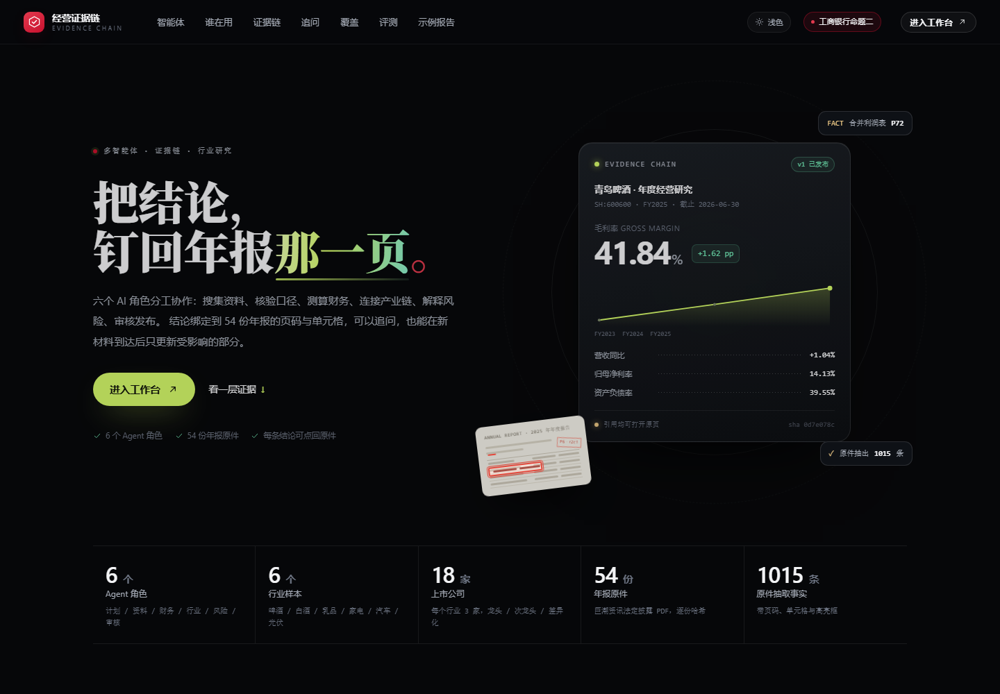

首页首屏是产品入口；右侧报告卡从本机 API 取数。向下是产品台：
研究台 / 报告 / 证据地图三个标签都渲染真实数据，不是截图。
再往下是「谁在用」的三类用户、六个 Agent 的角色边界，以及可复核的评测终端。

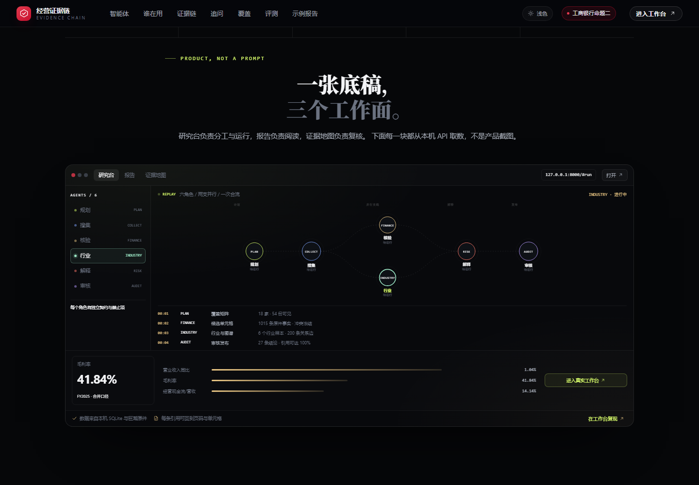

产品台把一个产品拆成三个工作面：左边是六个 Agent 与实时事件，中间是调度图，
底部是当期产出；切到「报告」标签可以看到带引用的阅读版式与多轮追问。

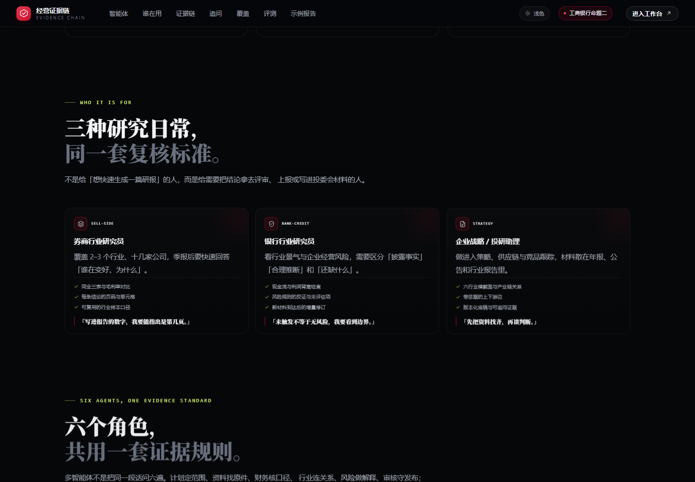

三类目标用户与各自的判断任务，回应赛题「把目标使用者和问题讲清楚」。

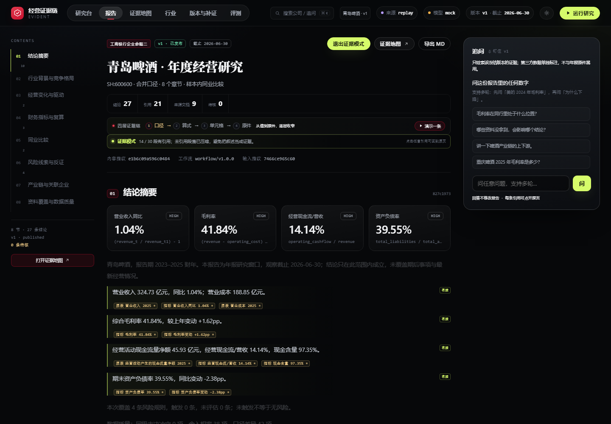

报告页的「证据模式」：有引用的段落高亮并标注「有据」，未引用段落压暗。
它把「这页有多少内容真的有证据」变成一眼可见的状态，而不是一句声明。

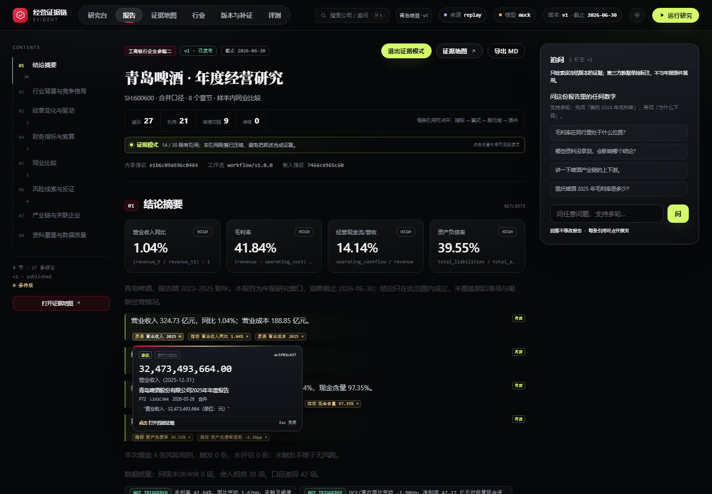

悬停任意引用，不离开阅读位置就能看到：指标数值、原件标题、页码、单元格和摘要；
点击仍然打开四层证据抽屉。预览支持键盘聚焦、Esc 关闭、视口边缘翻转与滚动让位。

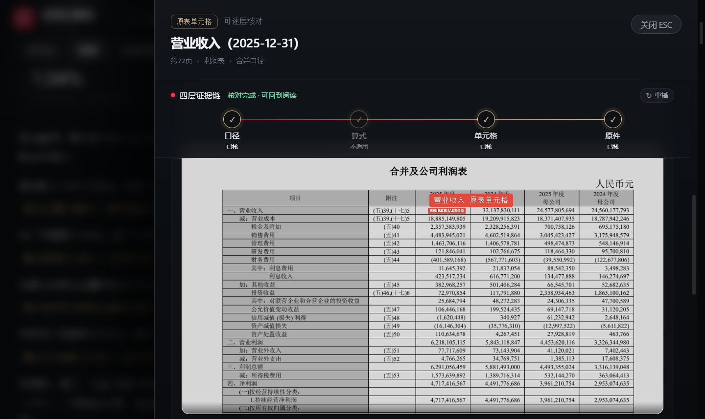

点击报告页「演示一条」或正文里的任意数字：抽屉从右滑出，顶部固定的四层链按
口径 → 算式 → 单元格 → 原件 依次点亮；可暂停、重播，也可点任意一层直接跳过去。
动画只负责引导，每一层仍然是真实接口返回的值、公式、单元格与原页。

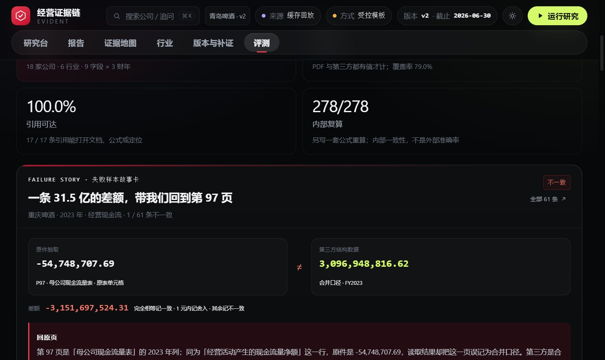

评测页不只是一张失败表：挑 1 条真实 mismatch，把原件 −54,748,707.69、第三方
3,096,948,816.62、差额与页码放在一起；回原页发现取到的是「母公司现金流量表」，
而抽取记录标成了合并口径。失败不是被删掉，而是被解释清楚，并可继续打开四层证据。

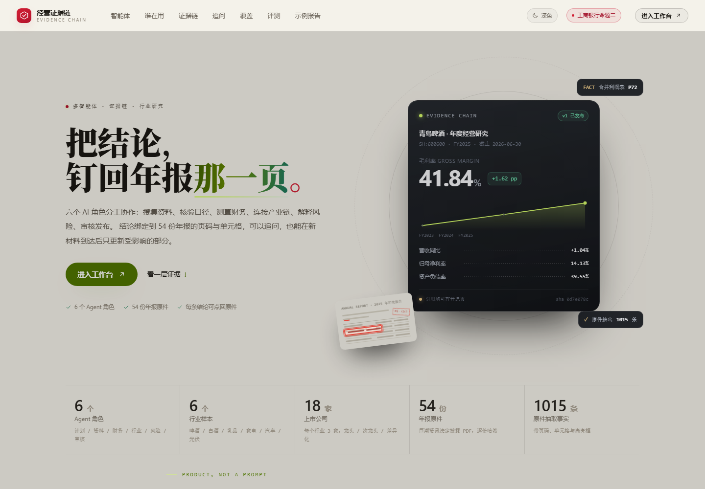

右上角可切换深色 / 浅色，选择写入本地存储并在首帧前生效。浅色主题是暖纸底，
报告卡、评测终端与证据地图保留为深色「产品屏」；青柠仍是行动色，
人大红 / 工行红只出现在徽标、命题印章、章节编号与关键状态上，不大面积铺色。

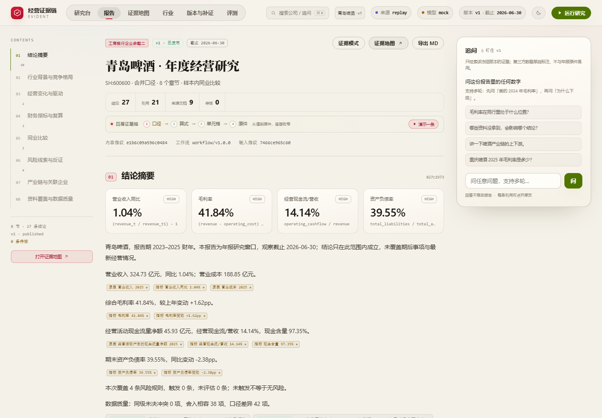

浅色下的报告页仍保持证据阅读的层次：KPI、引用 chip、证据模式与追问栏都能正常使用。

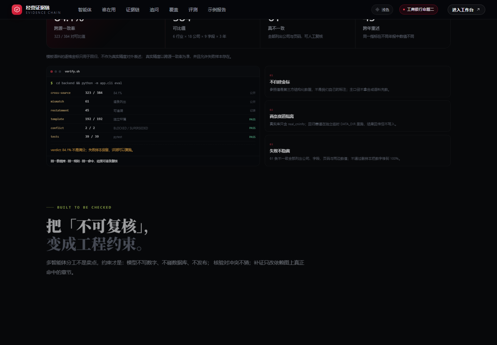

评测不给自己出题：一边年报原件，一边第三方结构化数据；失败样本全部列出；
回归赛道在独立临时目录运行，主库保持单一 `real_cninfo`。

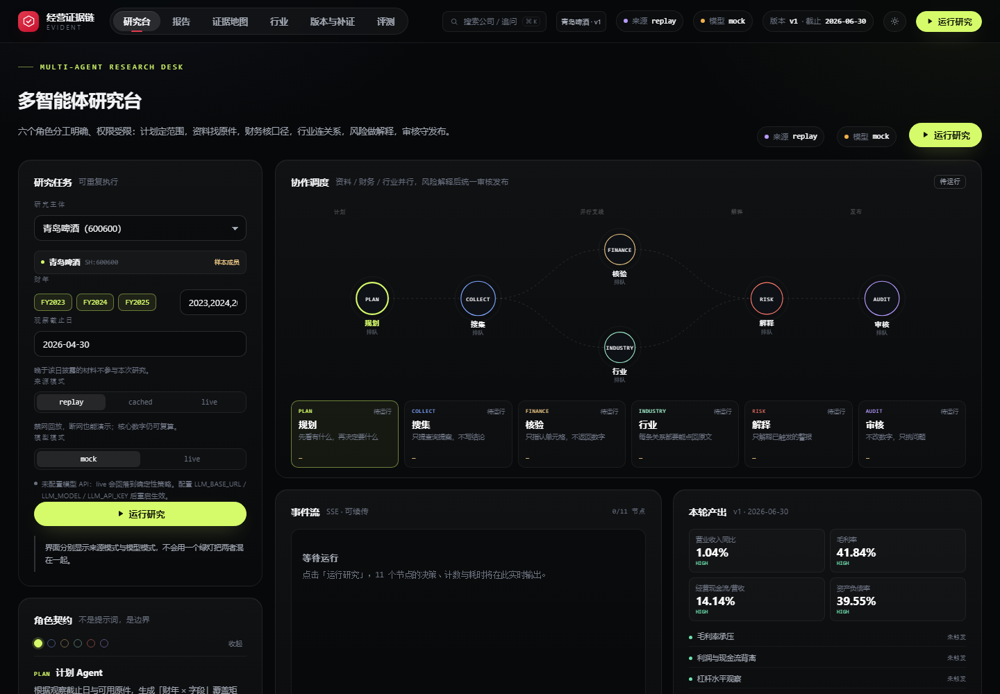

研究台把「谁负责什么、能碰什么」画出来：每个 Agent 有独立契约与禁止项，运行状态与产出计数实时回填。

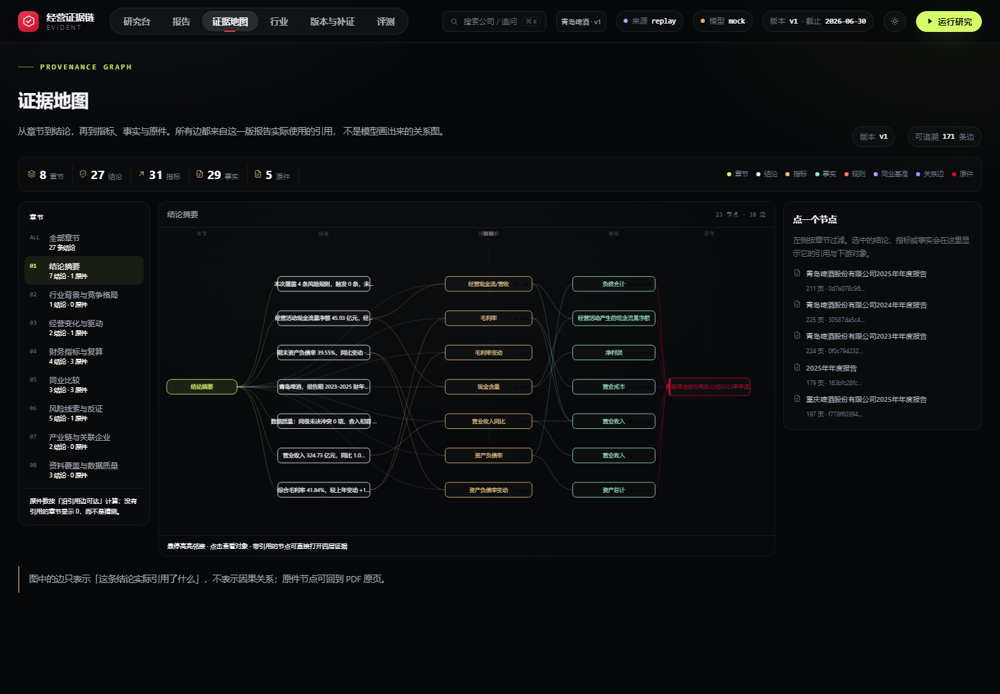

证据地图从这一版报告的实际引用生成；悬停高亮邻接，点击节点看数值/审核/邻接，带引用的节点可打开四层证据。

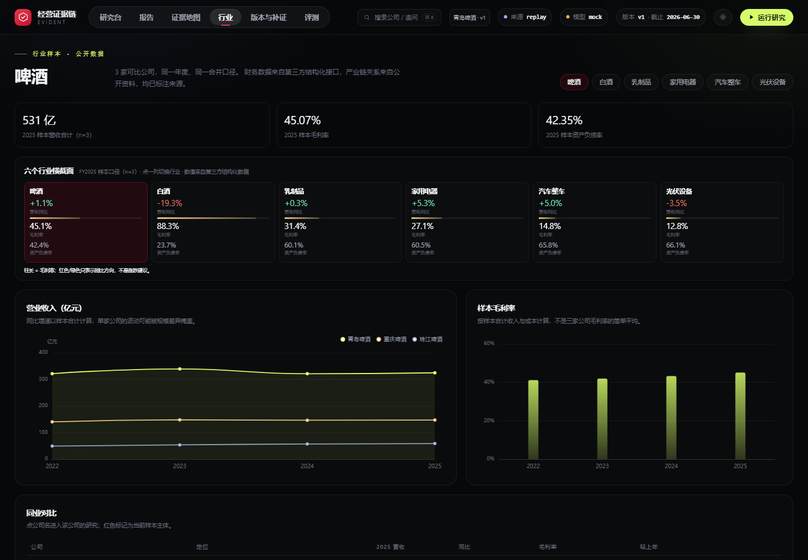

行业页：六行业横截面、样本营收与毛利率、同业表、可交互产业链图（悬停高亮邻接、点击看依据）。

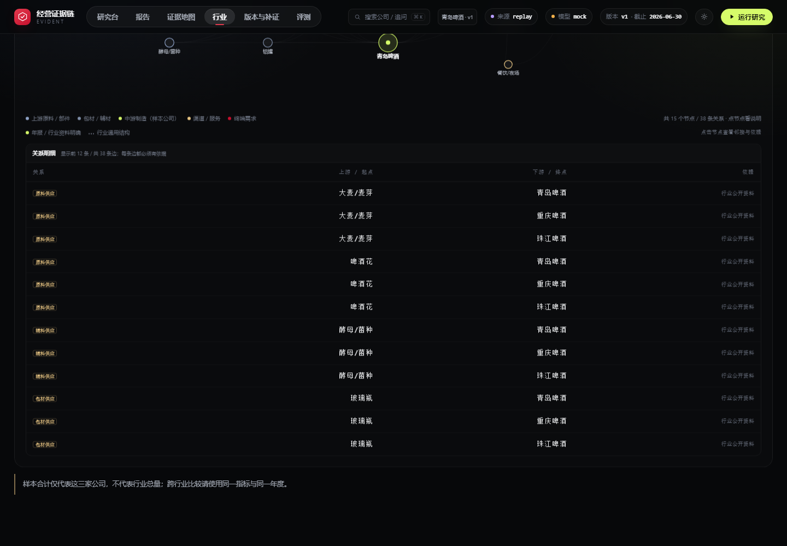

产业链图下方是关系明细：每条边给起点、终点、关系类型与依据；
无法确认的商业关系不会画成实线。

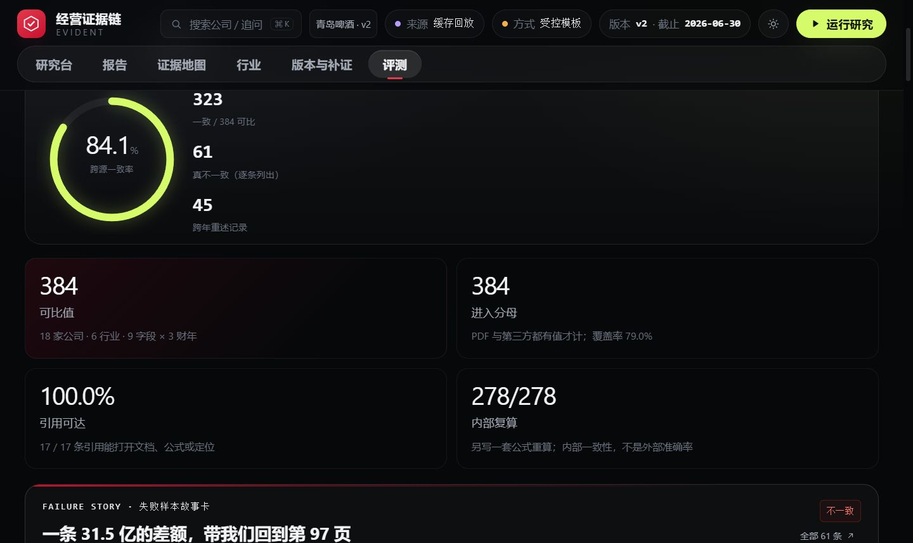

评测页公开一致率、失败分类与失败样本——**不隐藏失败**是这一页的设计目的；
回归赛道在独立临时库运行，主库保持单一 `real_cninfo` 数据集。

界面细节：`frontend/src/styles.css`（设计令牌与动效）、`frontend/src/product.css`（产品层）、
`components/AgentFlow.tsx`（协作图）、`components/ProductShowcase.tsx`（首页产品台）、
`views/ProvenanceView.tsx`（证据地图）、`components/CommandPalette.tsx`（⌘K 搜索与追问）、
`theme.ts` + `components/ThemeToggle.tsx`（深/浅主题）、`components/EvidenceDrawer.tsx`（四层证据链）。
适配 390 / 768 / 1024 / 1440，支持 `prefers-reduced-motion`。

---

## 六、快速开始

```bash
# 0) 依赖
python -m venv .venv && ./.venv/Scripts/python.exe -m pip install -r backend/requirements.txt
cd frontend && npm install && npm run build && cd ..

# 1) 拉真实数据（首次约 2 分钟；已下载的年报不会重复下载）
cd backend
../.venv/Scripts/python.exe -m app.scripts.build_real --years 2023 2024 2025

# 2) 生成受控的「演练更正公告」（仅用于增量更新演示，界面会标注非真实披露）
../.venv/Scripts/python.exe -m app.scripts.add_demo_correction

# 3) 跑一次研究并启动
../.venv/Scripts/python.exe -m app.cli run
../.venv/Scripts/python.exe -m uvicorn app.main:app --host 127.0.0.1 --port 8000
```

Windows 可直接用 `.\start.ps1`；bash 用 `./start.sh`。
二者默认**不再导入合成语料**，避免污染跨源互证。

打开 <http://127.0.0.1:8000/>。`--mode replay` 只读缓存，断网也能演示。

```bash
# 评测 / 测试
../.venv/Scripts/python.exe -m app.cli eval
../.venv/Scripts/python.exe -m pytest tests -q
```

回归赛道需要独立数据目录（不要与真实库混装）：

```bash
# PowerShell
$env:DATA_DIR="data/regression"; python -m app.cli seed --pack beer-demo
# bash
DATA_DIR=data/regression python -m app.cli seed --pack beer-demo
```

评测页会自动在临时目录启动子进程跑回归赛道，主库保持单一 `real_cninfo`。

---

## 七、架构

```
backend/app
├─ domain/        事实键、字段字典、公式、规则、数字守卫、Claim 模板
├─ agents/        六个角色的契约、提示词与确定性策略（catalog 供前端读取）
├─ services/
│  ├─ market.py        第三方结构化数据（东财，带缓存）
│  ├─ filings.py       巨潮年报检索与下载（orgId 查表）
│  ├─ pdf_lines.py     真实年报行锚定抽取器（对齐方式 / 跨页 / 合并母公司）
│  ├─ real_ingest.py   抽取结果入库
│  ├─ verify.py        事实核验与冲突判定（含跨源差异）
│  ├─ analysis.py      指标、同业基准（缺失时用第三方补值并标记）
│  ├─ sectors.py       行业样本聚合、六行业矩阵与产业链
│  ├─ provenance.py    证据地图：章节 → 结论 → 指标 → 事实 → 原件
│  ├─ report.py        章节合成、依赖图、版本发布
│  ├─ qa.py            自由文本追问（实体/年份/指标/意图 + 多轮继承）
│  └─ issues.py        质量问题按原因聚合
├─ workflow/       自写 DAG 执行器（11 节点，两支并行）
├─ eval/           跨源互证 + 隔离的合成回归（regression.py 子进程）
└─ providers/llm.py OpenAI 兼容通道（含数字守卫）
```

**为什么不用 LangGraph**：11 个节点、两支并行、需要 SSE 逐节点回放与可重放工件。
自写 130 行执行器足够，且不引入现场装不上的依赖。详见 `docs/ADR-0001-workflow-engine.md`。

大模型是可选项。可接入阿里云百炼的 OpenAI 兼容接口（模型如 `qwen-flash`）：

```bash
export LLM_BASE_URL=https://dashscope.aliyuncs.com/compatible-mode/v1
export LLM_MODEL=qwen-flash
export LLM_API_KEY=...            # 只放环境变量，不写入仓库
```

启用后有三个用途：

1. **研究台的「大模型」模式**：六个角色按固定字段交付，校验失败先修复一次，仍失败自动回落确定性模板；
2. **报告首页的「AI 阅读提示」**：只写「先看什么、再核对什么」，不出现数字、日期或因果断言，不参与结论；
3. **追问的语义辅助**（建议项，当前默认走版本内检索）：只用于问题归类和改写，数字与引用仍由检索结果给出。

未配置时整条链路走确定性策略，界面明确标注；数字、结论与发布判定从不由模型决定。

---

## 八、明确没做的事

- 不做扫描件 OCR（无文本层标 `SCANNED_UNSUPPORTED`，允许人工录入候选）。
- 不做向量库、多租户、实时行情；产业链图是结构化边表，126 节点 / 324 条关系。
- 不输出投资建议或授信结论；资产负债率是观察线索，不等同于有息债务口径。
- 没有鉴权，只监听本机；真实上线需要 SSO、最小权限、租户隔离与审计留存。
- 抽取器对真实年报仍有约 16% 的不一致（见评测页），失败样本已分类列出，不做美化。

---

## 九、文档

| 文件 | 内容 |
|---|---|
| `docs/演示脚本_1分钟.md` | 初赛视频的分镜、逐秒口播与要展示的界面状态 |
| `docs/评测口径.md` | 跨源互证的定义、容差、失败归因与不可比的边界 |
| `docs/实施与验收说明.md` / `.docx` | 正式实施与验收报告：交付对照、契约、判定策略、接口、局限 |
| `docs/ADR-0001-workflow-engine.md` | 为什么用极简 DAG 执行器 |

---

## 十、数据与许可

年报原件来自巨潮资讯（交易所指定披露平台），仅用于本地研究演示，不随仓库分发；
第三方结构化数据来自东方财富公开接口，接口地址与抓取时间随事实入库。
合成语料由 `backend/fixtures/gen_corpus.py` 生成，仅用于抽取器回归测试。
